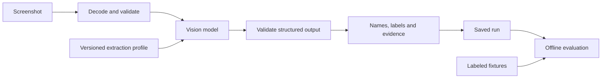

# ScreenshotAnalysis

**AI-powered screenshot analysis with multimodal models, structured extraction and reproducible evaluation.**

ScreenshotAnalysis turns screenshots into structured metadata using an OpenAI vision model. It extracts visible names, classifies content and links each mention to evidence and its source context—including screenshots embedded inside other screenshots.

Built in C# / .NET, it provides an asynchronous library API, a CLI and an evaluation harness. Versioned profiles define the extraction task, so applications can adapt the same engine to different archives and image-review workflows.

## AI engineering approach

- **Structured model output:** a fixed JSON schema, followed by application validation of labels and context references.
- **Evaluation workflow:** labeled development and held-out splits, name and classification precision/recall, failure rate and per-case results. Saved runs can be rescored without another model call.
- **Traceable experiments:** image hashes, model identifiers and profile/prompt/schema versions accompany each result, together with latency and token usage. Cost estimates require an explicitly dated pricing configuration.
- **Reliable inference handling:** bounded retries, cancellation and distinct outcomes for refusals, incomplete responses and provider failures. A failed extraction never becomes an apparently successful empty result.
- **Explicit trust boundaries:** text inside images is treated as data. The extraction call has no tools or external actions; this design does not establish measured prompt-injection resistance.
- **Testable provider integration:** core contracts are separate from the OpenAI adapter. Mocked responses and offline replay exercise the pipeline without credentials or API charges.

The baseline uses one full-image vision request per screenshot. Prompt and model changes can be compared against the same labeled inputs before adding more processing stages.

## Analysis pipeline



## Features

- PNG, JPEG and WebP input, as individual files or a directory.
- Multiple content labels and repeated name mentions with roles, evidence and nested source contexts.
- An asynchronous API with cancellation, plus a separate OpenAI adapter using structured outputs.
- Explicit failures for invalid input, provider errors, refusals and incomplete responses.
- Image hashes, model/profile/schema versions, timing and token usage in saved results.
- Offline replay and evaluation against versioned, labeled fixtures.
- Optional name-tag normalization that preserves raw mentions and evidence.

Extracted names are observations, not verified identities. A valid JSON response does not establish extraction accuracy. Public examples are synthetic fixtures; replay scores are pipeline checks, not model benchmarks.

## Requirements

- .NET 10 SDK.
- For live analysis, an OpenAI API key and an explicitly configured model supporting images and structured outputs.

Native image decoding uses SkiaSharp. Windows has been tested locally; Linux and macOS have not been verified.

## Quick start: no API key required

Run from the repository root:

```powershell
dotnet test ScreenshotAnalysis.sln

dotnet run --project engine/src/ScreenshotAnalysis.Cli -- analyze --manifest engine/fixtures/development.json --profile engine/examples/generic-profile.json --replay engine/fixtures/replay --out artifacts/demo.jsonl

dotnet run --project engine/src/ScreenshotAnalysis.Cli -- evaluate --manifest engine/fixtures/development.json --runs artifacts/demo.jsonl --out artifacts/demo-report.json
```

Output files are create-only. Choose a new output filename when repeating a command. The separate `engine/fixtures/held-out.json` split can be used with the same workflow.

## Run AI analysis on your screenshots

Configure `OPENAI_API_KEY` and `OPENAI_MODEL` in your environment. Create a profile based on [generic-profile.json](engine/examples/generic-profile.json), defining the classifications and extraction guidance for your use case.

```powershell
dotnet run --project engine/src/ScreenshotAnalysis.Cli -- analyze --input "path/to/screenshots" --profile "path/to/profile.json" --live --out artifacts/screenshots.jsonl
```

Directory input is nonrecursive. `--live` sends images to OpenAI and incurs provider charges. Processing is sequential. Every JSONL record contains a result or an explicit failure, and complete records are flushed as processing proceeds. Images are limited to 20 MiB and 25 megapixels; animated images are rejected.

Inspect derived name tags without another provider call:

```powershell
dotnet run --project engine/src/ScreenshotAnalysis.Cli -- tags --runs artifacts/screenshots.jsonl --out artifacts/tags.jsonl
```

Names are grouped ignoring capitalization while preserving spelling and punctuation. Applications that intentionally equate digit zero with letter O can opt into `--name-matching zero-o` for tag export and evaluation. Raw names and evidence remain unchanged.

## Library API

```csharp
using ScreenshotAnalysis;
using ScreenshotAnalysis.OpenAI;

using var http = new HttpClient { Timeout = Timeout.InfiniteTimeSpan };
var analyzer = new OpenAiScreenshotAnalyzer(http, new OpenAiOptions(
    Environment.GetEnvironmentVariable("OPENAI_MODEL")!,
    Environment.GetEnvironmentVariable("OPENAI_API_KEY")!));

var profile = AnalysisJson.Read<ExtractionProfile>(
    await File.ReadAllTextAsync("profile.json"));
var image = await ScreenshotImage.LoadAsync("screenshot.png");
var result = await analyzer.AnalyzeAsync(image, profile, CancellationToken.None);

foreach (var name in result.NameCandidates)
    Console.WriteLine($"{name.Name}: {name.MentionIds.Length} mention(s)");
```

Reuse `HttpClient` in hosted applications. Core contracts do not depend on OpenAI; additional providers can implement `IScreenshotAnalyzer`.

## Project layout

- `ScreenshotAnalysis.sln`: repository-level solution.
- `engine/src/`: core library, OpenAI adapter, CLI and evaluation harness.
- `engine/tests/`: contract, provider and CLI tests with mocked responses.
- `engine/examples/`: generic extraction profile.
- `engine/fixtures/`: redistributable synthetic images, labels and offline replay data.
- `engine/tools/`: synthetic-fixture generation and deterministic image upscaling.
- `engine/docs/`: architecture and evaluation methodology.

The engine directory also contains a standalone solution for using it independently.

## Documentation

- [Full engine guide](engine/README.md)
- [Architecture](engine/docs/architecture.md)
- [Evaluation methodology](engine/docs/evaluation.md)

Applications own their domain profiles, storage, search, canonical identities and review/correction workflows. The library supplies evidence-backed extraction and evaluation primitives.

## Packaging and license

```powershell
dotnet pack ScreenshotAnalysis.sln -c Release -o artifacts/packages
```

Packaging creates local artifacts; it does not publish them. Code and generated synthetic fixtures use the [MIT license](LICENSE). Dependencies retain their own licenses.
